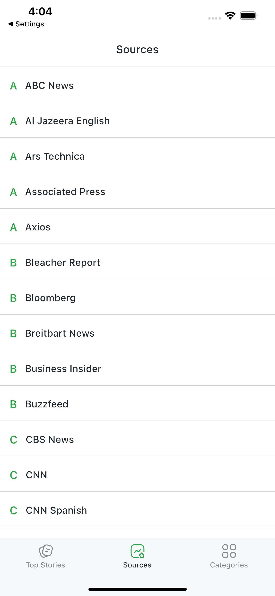
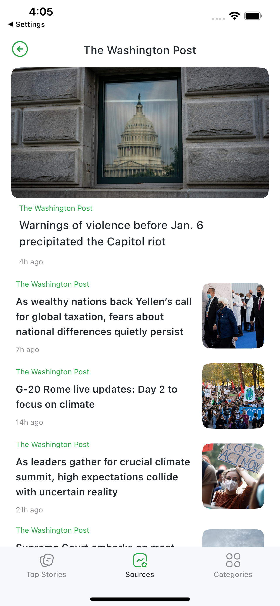

# Flutter News App

A simple news app with a minimalistic and modern UI that incorporates the [newsapi.org](https://newsapi.org) api all built entirely with Flutter. Be sure to leave a star 🌟

 </img>

## Features

- _Top stories feed:_ Get top stories from around the globe.
- _Search by category:_ Look at different articles by category such as Business, Health, etc.
- _Search by source:_ Look at news from specified source such as CNN, BBC News etc.
- _COVID-19 Section:_ A designated section for Coronavirus news.
- _Dark mode:_ Dark theme and light theme support

## Getting started
1. Obtain API key from [newsapi.org](https://newsapi.org)
2. Navigate to `lib/src/config/environment_config.dart` and replace `YOUR_API_KEY_HERE` with your API key
3. Run app

## Dependencies

 - [canton_design_system](https://github.com/31Carlton7/canton_design_system)
 - flutter_riverpod
 - dio
 - flutter_easyrefresh
 - intl

## Screenshots

   </img>
   </img> 
   </img>
   </img>
   </img>
   </img>

## Socials

If you have any questions, you can reach me here:

- Instagram: [@31Carlton7](https://www.instagram.com/31carlton7/)
- Email: carltonaikins7@gmail.com

In God we trust 🙏🏾
